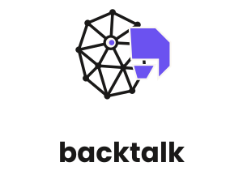

<p align="center">
  <picture>
    <source media="(prefers-color-scheme: dark)" srcset="docs/assets/backtalk-lockup-dark.svg">
    
  </picture>
</p>

# backtalk

A realtime speech server for the house: it hears and transcribes speech on the GPU and reads replies aloud in
Chimera's voice, over the OpenAI Realtime protocol.

backtalk is a read-back speech server. It has no language model. It detects where speech starts and stops in the
audio it's sent and transcribes each turn with NVIDIA's Parakeet TDT 0.6B v3, and it says the text it's given in
Chimera's voice, through [chimera-tts](https://github.com/lowmagic/chimera-tts)'s speak build. A
session that asks it to answer on its own is refused. The [spec](docs/SPEC.md) says exactly what it sends and
accepts.

## How Conduit uses it

Conduit never connects to backtalk itself. The Hermes host's
[conduit_push](https://github.com/kaishi00/hermes-conduit-notifier) plugin relays Conduit's realtime events to the
speech server set for the profile (`voice.speech_server.url`, with `api_key` as the bearer key), and it knows what
to do with a read-back server (its README's "Local Live on a read-back speech server"):

- A Local Live call's first `session.update` asks for automatic responses. backtalk refuses it with
  `realtime_live_unavailable`, and the plugin sends it again with automatic responses off and runs the call
  itself, out of Conduit's sight.
- Each turn backtalk transcribes starts a Hermes turn (or the call's fast model, in agent mode). The plugin sends
  the reply back as it streams, a sentence per `response.create`, and backtalk reads each one aloud.
- When the user talks over the reply, the plugin sees backtalk's `speech_started` and cancels the reading. The
  Interrupt button sends the same `response.cancel`.
- Classic voice opens two sockets: one sends the microphone for transcription, and the other sends the reply a
  sentence at a time, as a user item and a `response.create`, for backtalk to read. Either way the transcript of
  each reading is exactly its text, which both the plugin and Conduit check.

Agent mode needs a fast model of its own, which backtalk doesn't run. [docs/call-model.md](docs/call-model.md) is
the reference setup for one on the same GPU host, llama.cpp serving Ministral 3 8B, and how it was chosen.

## Running it

backtalk runs as the container image CI publishes from main, `ghcr.io/lowmagic/backtalk:<full commit SHA>`, on
a host with an NVIDIA GPU (CUDA 13; a driver of 580 or later). The image serves the realtime socket on port 8765
at `/v1/realtime` and runs as uid 8765. It reads:

| Variable | What it is |
| --- | --- |
| `BACKTALK_SPEAK` | The speak worker, `speak/speak.mjs` in chimera-tts's build. Mount the build read-only, at `/srv/chimera` say, and set `/srv/chimera/speak/speak.mjs`. |
| `BACKTALK_SPEAK_FLAGS` | Optional. The voice's settings, as flags for the speak worker, such as `--rate 0.9 --voicing 1.5 --plosives 1.5`: speed, more voice in b, d, g, v, z, and harder p, t, k, b, d, g (chimera-tts's README lists them all). Left out, the build's defaults. A flag the build doesn't take stops backtalk at start, saying which. |
| `BACKTALK_API_KEY` | Optional. When set, every connection must send `Authorization: Bearer <key>` or is refused with 401. Put the same key in the profile's `voice.speech_server.api_key`. |
| `BACKTALK_CACHE` | Where the models download on first start (about 2.6 GB) and load from after. The image sets `/var/cache/backtalk`; mount a persistent volume there, writable by uid 8765. |

With podman and the NVIDIA Container Toolkit's CDI spec:

```sh
podman run -d --name backtalk --device nvidia.com/gpu=all \
  -p 192.168.1.20:8765:8765 \
  -v /srv/chimera:/srv/chimera:ro -v backtalk-cache:/var/cache/backtalk \
  -e BACKTALK_SPEAK=/srv/chimera/speak/speak.mjs -e BACKTALK_API_KEY \
  ghcr.io/lowmagic/backtalk@sha256:<digest>
```

Then set the profile's speech server to `ws://192.168.1.20:8765/v1/realtime` and run Conduit's speech server test.
The first start downloads the models before it listens; a start finds them by hash and listens within seconds.
backtalk logs to stderr: which device it transcribes on, sessions, and how long each transcription and reading
took, never the words.

### Sharing the GPU with corral

backtalk holds the GPU for as long as it runs. A [corral](https://github.com/lowmagic/corral) worker on the same
host that offers `gpu` counts any GPU process it doesn't know as foreign and stops taking GPU work while it's there.
List backtalk's process under the worker's `ignore`, by the name the image gives it:

```toml
ignore = ["backtalk-server"]
```

Check the name with `nvidia-smi --query-compute-apps=pid,process_name --format=csv` while backtalk runs.

### Locally

On a Mac, `uv run backtalk` runs it on the CPU, listening on port 8765 on every address:

```sh
BACKTALK_CACHE=~/.cache/backtalk BACKTALK_SPEAK=../chimera-voice-chat/dist/speak/speak.mjs uv run backtalk
```

`make check` runs the checks CI runs, offline, with a fake model and a fake speak worker. `make standards` checks
the org standards copies and needs the network.

## Models

- [Parakeet TDT 0.6B v3](https://huggingface.co/nvidia/parakeet-tdt-0.6b-v3) by NVIDIA, CC BY 4.0, as exported to
  ONNX in [istupakov/parakeet-tdt-0.6b-v3-onnx](https://huggingface.co/istupakov/parakeet-tdt-0.6b-v3-onnx).
- [Silero VAD](https://github.com/snakers4/silero-vad), MIT, as
  [istupakov/silero-vad-onnx](https://huggingface.co/istupakov/silero-vad-onnx).

Both are pinned to a commit and checked by sha256 in `src/backtalk/models.py`.
